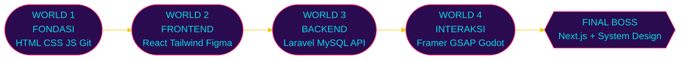
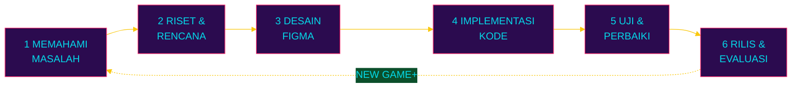
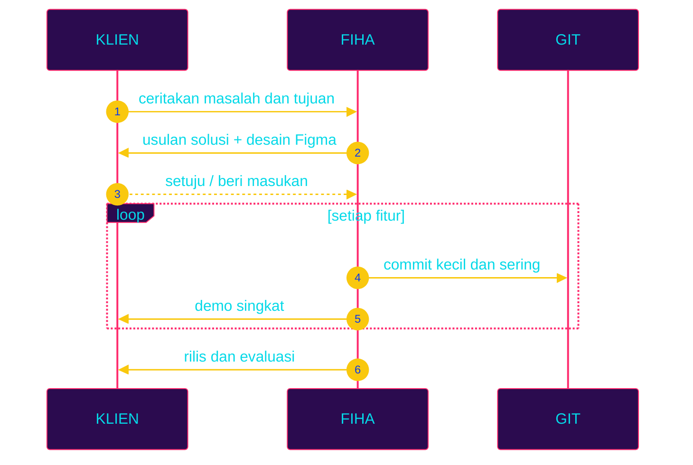

<!--
  ╔══════════════════════════════════════════════════════════════╗
  ║  PROFILE README · RETRO ARCADE EDITION · F1H444              ║
  ║  Tempel sebagai README.md di repositori F1H444/F1H444.       ║
  ║  Palet synthwave: #0D0221 gelap · #7B2FF7 ungu · #FF2A6D     ║
  ║  pink · #05D9E8 cyan · #F9C80E kuning                        ║
  ╚══════════════════════════════════════════════════════════════╝
-->

<a id="top"></a>

<div align="center">


```text
███████╗██╗██╗  ██╗ █████╗ 
██╔════╝██║██║  ██║██╔══██╗
█████╗  ██║███████║███████║
██╔══╝  ██║██╔══██║██╔══██║
██║     ██║██║  ██║██║  ██║
╚═╝     ╚═╝╚═╝  ╚═╝╚═╝  ╚═╝
   A R I D H O I  ·  F 1 H 4 4 4
```

<a href="https://github.com/F1H444">
  
</a>

<br/>


<br/><br/>

<!-- MENU UTAMA -->
<a href="#player"></a>
<a href="#stage"></a>
<a href="#powerup"></a>
<a href="#inventory"></a>
<a href="#quest"></a>
<a href="#shop"></a>
<a href="#loop"></a>
<a href="#score"></a>
<a href="#cheat"></a>
<a href="#continue"></a>

</div>

<br/>

<!-- ═══════════ PLAYER SELECT ═══════════ -->

<a id="player"></a>


## 🕹️ PLAYER SELECT

<table>
<tr>
<td width="55%" valign="top">

```text
╔══════════════════════════════════════╗
║        ** CHARACTER SHEET **         ║
╠══════════════════════════════════════╣
║ PLAYER 1 : FIHA ARIDHOI              ║
║ CLASS    : SOFTWARE ENGINEER         ║
║ BASE     : SURABAYA, ID              ║
║ GUILD    : F1H444                    ║
║ WEAPONS  : REACT/LARAVEL/GODOT       ║
║ FUEL     : COFFEE                    ║
║ STATUS   : OPEN FOR COLLAB           ║
╚══════════════════════════════════════╝
```

</td>
<td width="45%" valign="middle" align="center">


</td>
</tr>
</table>

Halo, saya **Fiha Aridhoi**, mahasiswa **software engineering** dari **Surabaya, Indonesia**. Saya paling senang mengubah ide menjadi sesuatu yang benar-benar bisa dipakai: website yang cepat dibuka, aplikasi yang tidak membingungkan, atau game kecil yang asyik dimainkan.

Tiga atribut yang saya kejar di setiap proyek: ⚡ **efisien**, 💡 **inovatif**, dan 🤝 **user-friendly**.

**ENERGI FOKUS** *(ilustratif, tergantung proyek yang sedang jalan)*

```text
WEB     [████████░░]  80%
GAME    [██████░░░░]  60%
UI/UX   [███████░░░]  70%
BELAJAR [█████████░]  90%
```

<div align="right"><a href="#top">▲ BACK TO TITLE</a></div>

<!-- ═══════════ STAGE SELECT ═══════════ -->

<a id="stage"></a>


## 🌆 STAGE SELECT

<div align="center">
<table>
<tr>
<td align="center" width="33%" valign="top">

### 🖥️
**STAGE 1-1**
**WEB DEVELOPMENT**

<sub>React dan Next.js untuk antarmuka modern, cepat, dan responsif di semua layar.</sub>

</td>
<td align="center" width="33%" valign="top">

### 👾
**STAGE 1-2**
**GAME DEVELOPMENT**

<sub>Godot dan GDScript untuk game 2D yang ringan dengan gameplay yang enak.</sub>

</td>
<td align="center" width="33%" valign="top">

### 🎨
**STAGE 1-3**
**UI/UX DESIGN**

<sub>Figma untuk merancang alur dan tampilan sebelum satu baris kode ditulis.</sub>

</td>
</tr>
</table>
</div>

<details>
<summary><b>▶ BACA BRIEFING TIAP STAGE</b></summary>

<br/>

**Web.** Frontend dengan React, Next.js, dan Tailwind CSS. Backend dengan Laravel dan MySQL untuk logika bisnis, autentikasi, dan data. Yang selalu dijaga: cepat dimuat, konsisten di ponsel dan desktop, kode mudah dilanjutkan siapa pun.

**Game.** Tempat bereksperimen paling bebas: bagaimana karakter bergerak, bagaimana level terasa, bagaimana umpan balik visual membuat aksi pemain memuaskan. GDScript mirip Python, jadi iterasi cepat.

**Design.** Alur pengguna, kerangka halaman, warna, dan tipografi di Figma. Setelah desain disepakati, implementasi jauh lebih terarah.

</details>

<div align="right"><a href="#top">▲ BACK TO TITLE</a></div>

<!-- ═══════════ POWER-UPS ═══════════ -->

<a id="powerup"></a>


## 🍄 5 POWER-UP FILOSOFI

| | Power-up | Efeknya |
| :---: | :--- | :--- |
| 🍄 | **Mulai dari masalah** | Tanya dulu siapa penggunanya dan apa masalahnya. Teknologi hanyalah alat. |
| ⭐ | **Sederhana itu elegan** | Kode mudah dibaca mengalahkan kode yang terlihat pintar. |
| 🔥 | **Animasi punya tujuan** | Gerakan harus membantu pengguna paham, bukan sekadar menghias. |
| 🪙 | **Belajar sambil membangun** | Konsep paling melekat saat dipakai di proyek nyata. |
| 💎 | **Bagikan ilmunya** | Open source: membaca, memperbaiki, dan membuka hasil kerja. |

<div align="right"><a href="#top">▲ BACK TO TITLE</a></div>

<!-- ═══════════ INVENTORY ═══════════ -->

<a id="inventory"></a>


## 🎒 INVENTORY (TECH STACK)

<div align="center">

**⚔️ SENJATA UTAMA (BAHASA)**


<br/><br/>

**🛡️ PERISAI (FRONTEND)**


<br/>


<br/><br/>

**🧪 RAMUAN (BACKEND & DATABASE)**


<br/><br/>

**🧰 PERALATAN (GAME & TOOLS)**


</div>

<br/>

<details open>
<summary><b>▶ ⚔️ BAHASA</b></summary>

<br/>

| Item | Dipakai untuk |
| :--- | :--- |
| **JavaScript** | Logika interaktif di browser dan dasar ekosistem frontend |
| **TypeScript** | Tipe agar kesalahan ketahuan sebelum aplikasi jalan |
| **Python** | Skrip otomasi, olah data, eksperimen cepat |
| **PHP** | Backend web bersama Laravel |
| **C++** | Memahami program lebih dekat ke mesin dan struktur data |
| **C** | Pointer dan manajemen memori |
| **GDScript** | Logika game di Godot |

</details>

<details>
<summary><b>▶ 🛡️ FRONTEND</b></summary>

<br/>

| Item | Dipakai untuk |
| :--- | :--- |
| **React** | UI dari komponen yang bisa dipakai ulang |
| **Next.js** | Routing, rendering server, optimasi performa |
| **Tailwind CSS** | Menata tampilan cepat dan konsisten |
| **Bootstrap** | Prototipe cepat dengan komponen siap pakai |
| **Alpine.js** | Interaksi ringan tanpa framework besar |
| **Framer Motion** | Animasi halus dan deklaratif di React |
| **GSAP** | Animasi kompleks dengan kontrol timeline presisi |
| **Figma** | Wireframe, antarmuka, dan sistem desain |

</details>

<details>
<summary><b>▶ 🧪 BACKEND & DATABASE</b></summary>

<br/>

| Item | Dipakai untuk |
| :--- | :--- |
| **Laravel** | Routing, autentikasi, ORM, struktur proyek |
| **MySQL** | Database relasional |
| **Postman** | Uji dan dokumentasi endpoint API |

</details>

<details>
<summary><b>▶ 🧰 GAME & TOOLS</b></summary>

<br/>

| Item | Dipakai untuk |
| :--- | :--- |
| **Godot Engine** | Game 2D dan 3D yang ringan dan open source |
| **Git / GitHub / GitLab** | Riwayat perubahan, kolaborasi, hosting repositori |
| **VS Code** | Editor utama |
| **Android Studio** | Mengembangkan dan menguji aplikasi Android |

</details>

<div align="right"><a href="#top">▲ BACK TO TITLE</a></div>

<!-- ═══════════ QUEST LOG ═══════════ -->

<a id="quest"></a>


## 📜 QUEST LOG

```text
[▶] QUEST 1 : REACT ECOSYSTEM
    state, pola komponen, server components,
    data fetching, pengujian komponen
    HADIAH  : bisa merancang aplikasi React skala menengah

[▶] QUEST 2 : ADVANCED ANIMATIONS
    timeline, easing, scroll-triggered, transisi halaman
    HADIAH  : animasi natural yang tidak membebani performa

[▶] QUEST 3 : SYSTEM DESIGN
    aliran data, pemisahan komponen, skala pengguna
    HADIAH  : keputusan arsitektur yang bisa dipertanggungjawabkan
```



<details>
<summary><b>▶ CARA SAYA LEVEL UP</b></summary>

<br/>

1. **Pilih satu konsep kecil.** Misalnya hanya scroll animation, bukan seluruh GSAP.
2. **Buat contoh minimal yang jalan.** Satu halaman, satu efek.
3. **Rusak dengan sengaja.** Ubah parameter, hapus bagian, lihat apa yang pecah.
4. **Pakai di proyek nyata.** Konsep terasa dipahami setelah menyelesaikan masalah sungguhan.
5. **Tulis ulang dengan kata sendiri.** Kalau bisa dijelaskan sederhana, berarti sudah paham.

</details>

<div align="right"><a href="#top">▲ BACK TO TITLE</a></div>

<!-- ═══════════ SHOP ═══════════ -->

<a id="shop"></a>


## 🏪 ARCADE SHOP: PROGMAN

Selain belajar dan bereksperimen, saya menawarkan jasa pembuatan **website dan aplikasi untuk bisnis** lewat **ProgMan**.

<div align="center">

<a href="https://progman.is-a.dev/">
  
</a>

<br/>

<a href="https://progman.is-a.dev/">
  
</a>

</div>

<br/>

| Item | Cocok untuk | Hasil |
| :--- | :--- | :--- |
| 🎯 **Landing page** | Promosi produk atau acara | Satu halaman yang fokus pada konversi |
| 🏢 **Company profile** | Usaha yang ingin tampil profesional | Siapa Anda, layanan, dan kontak dalam satu situs |
| 🧩 **Web app** | Bisnis yang ingin merapikan proses | Login, dashboard, dan pengelolaan data |
| 📱 **Aplikasi mobile** | Layanan dekat dengan pengguna harian | Aplikasi nyaman di ponsel |
| ✨ **Perbaikan tampilan** | Situs lama yang kuno atau lambat | Antarmuka segar, cepat, mudah dipakai |

<details>
<summary><b>▶ KENAPA PROGMAN</b></summary>

<br/>

- **Desain bersih dan modern**, sesuai karakter bisnis Anda
- **Responsif** di ponsel, tablet, dan desktop
- **Cepat**, performa dijaga sejak awal
- **Komunikasi jelas**, Anda tahu apa yang dikerjakan dan langkah berikutnya
- **Bisa dikembangkan**, kode rapi agar fitur baru mudah ditambahkan

</details>

<div align="right"><a href="#top">▲ BACK TO TITLE</a></div>

<!-- ═══════════ GAME LOOP ═══════════ -->

<a id="loop"></a>


## 🔁 GAME LOOP (ALUR KERJA)





<details>
<summary><b>▶ DETAIL TIAP TAHAP</b></summary>

<br/>

| Tahap | Yang terjadi | Hasil |
| :--- | :--- | :--- |
| **1. Memahami masalah** | Siapa pengguna, apa tujuan, apa batasan | Daftar kebutuhan jelas |
| **2. Riset dan rencana** | Pilih teknologi, pecah jadi tugas kecil | Rencana dan urutan kerja |
| **3. Desain** | Wireframe, alur, warna, tipografi di Figma | Desain disetujui sebelum coding |
| **4. Implementasi** | Kode per fitur, commit kecil dan sering | Fitur berjalan |
| **5. Uji dan perbaiki** | Coba di banyak perangkat, rapikan bug dan performa | Produk stabil |
| **6. Rilis dan evaluasi** | Luncurkan, kumpulkan masukan, perbaiki | Siklus berikutnya |

</details>

<div align="right"><a href="#top">▲ BACK TO TITLE</a></div>

<!-- ═══════════ HI-SCORE ═══════════ -->

<a id="score"></a>


## 🏆 HI-SCORE

<div align="center">


<br/>


<br/><br/>


<br/><br/>


</div>

<!--
  ═══ SNAKE (OPSIONAL) ═══
  1. Simpan snake.yml ke .github/workflows/snake.yml
  2. Jalankan workflow "Generate Snake" sekali dari tab Actions
  3. Hapus tanda komentar di sekitar blok ini

<div align="center">
  
</div>
-->

<details>
<summary><b>▶ CARA MEMBACA SKOR</b></summary>

<br/>

- **Kartu statistik** merangkum bintang, commit, pull request, issue, dan kontribusi.
- **Streak** menghitung hari berturut-turut ada kontribusi. Konsistensi itu kebiasaan baik.
- **Bahasa terbanyak** dihitung dari ukuran kode di repositori publik, bukan berarti bahasa lain tidak dikuasai.
- **Grafik aktivitas** memperlihatkan naik turunnya kontribusi.

Layanan gambar ini gratis dan kadang lambat. Kalau sesekali kosong, itu karena servernya sibuk.

</details>

<details>
<summary><b>▶ ??? (RAHASIA)</b></summary>

<br/>

```text
 ↑ ↑ ↓ ↓ ← → ← → B A   START

 +30 LIVES UNLOCKED
 Terima kasih sudah membaca sampai sini. Kopi pertama saya traktir.
```

</details>

<div align="right"><a href="#top">▲ BACK TO TITLE</a></div>

<!--
  ═══ PROYEK UNGGULAN (OPSIONAL) ═══
  Ganti NAMA-REPO lalu hapus tanda komentar.


## 💾 SAVE FILES (PROYEK UNGGULAN)

<div align="center">
<a href="https://github.com/F1H444/NAMA-REPO-1"></a>
<a href="https://github.com/F1H444/NAMA-REPO-2"></a>
</div>
-->

<!-- ═══════════ CHEAT CODES / FAQ ═══════════ -->

<a id="cheat"></a>


## 🎮 CHEAT CODES (FAQ)

<details>
<summary><b>▶ Terbuka untuk kolaborasi?</b></summary>

<br/>

Ya, untuk proyek web, game, maupun open source. Buka issue atau diskusi di salah satu repositori saya, atau hubungi lewat situs ProgMan.

</details>

<details>
<summary><b>▶ Teknologi apa yang dipelajari pertama kali?</b></summary>

<br/>

Mulai dari HTML, CSS, dan JavaScript. Lalu pilih satu framework (misalnya React) dan bangun satu proyek kecil sampai selesai sebelum pindah ke teknologi lain.

</details>

<details>
<summary><b>▶ Berapa lama membuat website lewat ProgMan?</b></summary>

<br/>

Tergantung ruang lingkupnya. Landing page jauh lebih cepat daripada web app dengan login dan dashboard. Setelah kebutuhan jelas, estimasi bisa dibahas bersama.

</details>

<details>
<summary><b>▶ Kenapa Laravel dan Next.js sekaligus?</b></summary>

<br/>

Kekuatannya berbeda. Laravel nyaman untuk backend yang butuh struktur, autentikasi, dan database. Next.js unggul untuk frontend modern dengan performa baik. Keduanya bisa dipadukan: Laravel sebagai API, Next.js sebagai tampilan.

</details>

<details>
<summary><b>▶ Menerima proyek game?</b></summary>

<br/>

Game masih saya dalami lewat Godot, jadi saat ini lebih sering sebagai proyek pribadi dan eksperimen. Kalau ada ide menarik, silakan ajak ngobrol.

</details>

<details>
<summary><b>▶ Cara melaporkan bug?</b></summary>

<br/>

Buka tab **Issues** di repositori terkait. Sertakan langkah mengulang, hasil yang diharapkan, dan yang sebenarnya terjadi. Tangkapan layar sangat membantu.

</details>

<div align="right"><a href="#top">▲ BACK TO TITLE</a></div>

<!-- ═══════════ CONTINUE ═══════════ -->

<a id="continue"></a>


## 💿 CONTINUE?

<div align="center">


<br/>

<a href="https://github.com/F1H444"></a>
<a href="https://progman.is-a.dev/"></a>

<br/><br/>


<br/><br/>

<sub>Kalau Anda menyukai proyek saya, beri bintang pada repositorinya ⭐</sub>

<br/>

<i>"Code is like humor. When you have to explain it, it's bad."</i>

<br/><br/>

<sub>Dibuat dengan kopi dan rasa ingin tahu oleh <b>Fiha Aridhoi</b></sub>


</div>
