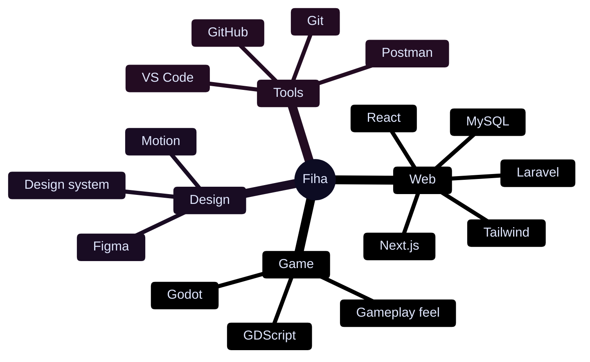
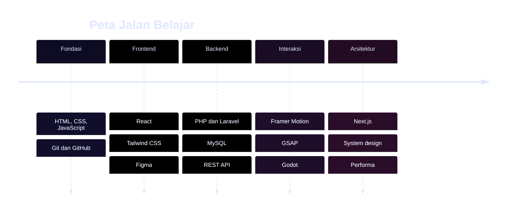
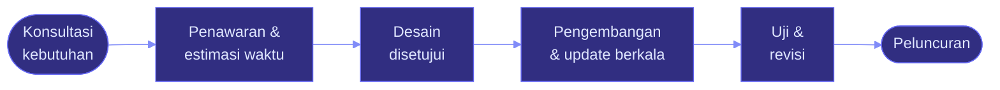
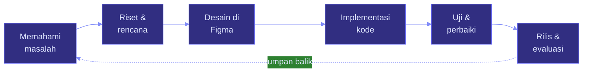
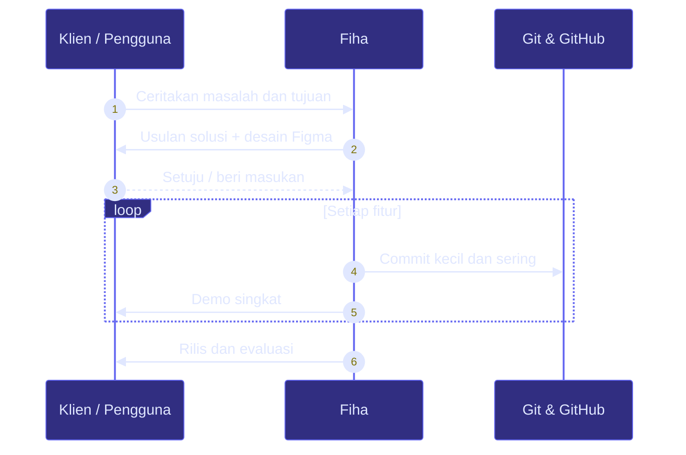

<!--
  ╔══════════════════════════════════════════════════════════════════╗
  ║  PROFILE README v2  ·  Fiha Aridhoi  ·  github.com/F1H444        ║
  ║                                                                  ║
  ║  Tempel sebagai README.md di repositori F1H444/F1H444.           ║
  ║  Semua animasi memakai layanan gambar eksternal, jadi tidak      ║
  ║  perlu folder assets. Snake (opsional) butuh GitHub Actions,     ║
  ║  lihat bagian bertanda "SNAKE" dan file snake.yml.               ║
  ║                                                                  ║
  ║  Palet: #0B0B14 gelap · #12122A permukaan · #6366F1 indigo       ║
  ║         #C7D2FE / #A5B4FC / #818CF8 teks muda                    ║
  ╚══════════════════════════════════════════════════════════════════╝
-->

<a id="top"></a>

<!-- ═══════════ 1. HERO ═══════════ -->

<div align="center">


<a href="https://github.com/F1H444">
  
</a>

<br/>


<br/><br/>

<!-- Navigasi -->
<a href="#tentang"></a>
<a href="#console"></a>
<a href="#filosofi"></a>
<a href="#fokus"></a>
<a href="#stack"></a>
<a href="#peta"></a>
<a href="#progman"></a>
<a href="#alur"></a>
<a href="#statistik"></a>
<a href="#faq"></a>
<a href="#kontak"></a>

</div>

<br/>

<!-- ═══════════ 2. TENTANG ═══════════ -->

<a id="tentang"></a>


##  Tentang Saya

<table>
<tr>
<td width="62%" valign="top">

Halo, saya **Fiha Aridhoi**. Saya mahasiswa yang sedang mendalami **software engineering** dan tinggal di **Surabaya, Indonesia**.

Hal yang paling saya nikmati adalah mengubah ide menjadi sesuatu yang benar-benar bisa dipakai orang: website yang cepat dibuka, aplikasi yang tidak membingungkan, atau game kecil yang asyik dimainkan.

Saya percaya perangkat lunak yang baik punya tiga ciri:

- ⚡ **Efisien**: hemat sumber daya dan waktu
- 💡 **Inovatif**: tidak sekadar meniru
- 🤝 **User-friendly**: orang awam pun langsung paham

</td>
<td width="38%" valign="middle" align="center">


</td>
</tr>
</table>

```ts
const fiha = {
  name:     "Fiha Aridhoi",
  username: "F1H444",
  location: "Surabaya, Indonesia",
  role:     "Software Engineering Student",

  focus:     ["Modern Web Development", "Game Development", "UI/UX Design"],
  learning:  ["React Ecosystem", "Advanced Animations", "System Design"],
  interests: ["Building Cool Stuff", "Open Source", "Problem Solving"],

  motto: "Learning by doing, growing by sharing",
  fuel:  "coffee -> code",

  openToCollaboration: true,
} as const;
```

<div align="right"><a href="#top">⬆ kembali ke atas</a></div>

<!-- ═══════════ 3. CONSOLE INTERAKTIF ═══════════ -->

<a id="console"></a>


##  Console Interaktif

Klik perintah di bawah untuk "menjalankannya".

<details>
<summary><code>$ ./whoami.sh</code></summary>

<br/>

```text
> Fiha Aridhoi (F1H444)
> Software Engineering Student · Surabaya, ID
> Suka: web modern, game 2D, animasi halus, antarmuka yang rapi
> Bahan bakar: kopi
```

</details>

<details>
<summary><code>$ ./now.sh</code></summary>

<br/>

| Sedang | Detail |
| :--- | :--- |
| 🧪 Mengeksplorasi | Next.js dan ekosistem React |
| 🎮 Membangun | Game 2D dengan Godot Engine |
| 🎞️ Melatih | Animasi scroll, timeline, dan transisi halaman |
| 🧠 Mempelajari | System design: aliran data dan arsitektur aplikasi |

</details>

<details>
<summary><code>$ ./ask-me-about.sh</code></summary>

<br/>

- React, Next.js, Tailwind CSS
- Laravel dan MySQL
- Godot dan GDScript
- Figma dan sistem desain
- Framer Motion dan GSAP
- Git, GitHub, dan alur kolaborasi

</details>

<details>
<summary><code>$ ./habits.sh</code></summary>

<br/>

```text
- mengubah kopi menjadi kode
- menambah fitur "sekali lagi" lalu lupa waktu
- merapikan antarmuka sampai jarak antar elemen pas
- mencoba tools baru tiap ada kesempatan
```

</details>

<details>
<summary><code>$ ./contact.sh</code></summary>

<br/>

```text
GitHub  : github.com/F1H444
ProgMan : progman.is-a.dev
```

</details>

<div align="right"><a href="#top">⬆ kembali ke atas</a></div>

<!-- ═══════════ 4. FILOSOFI ═══════════ -->

<a id="filosofi"></a>


##  Filosofi Kerja

<table>
<tr>
<td width="8%" align="center"><h3>01</h3></td>
<td width="92%">

**Mulai dari masalah, bukan dari teknologi.**
Siapa penggunanya, dan masalah apa yang ingin diselesaikan? Teknologi hanyalah alat. Pilihan yang tepat muncul setelah masalahnya jelas.

</td>
</tr>
<tr>
<td align="center"><h3>02</h3></td>
<td>

**Sederhana itu elegan.**
Kode yang mudah dibaca lebih berharga daripada kode yang terlihat pintar. Kalau sesuatu bisa disederhanakan tanpa kehilangan fungsi, saya sederhanakan.

</td>
</tr>
<tr>
<td align="center"><h3>03</h3></td>
<td>

**Animasi harus punya tujuan.**
Gerakan yang baik membantu pengguna memahami apa yang terjadi. Animasi yang hanya menghias dan mengganggu akan saya buang.

</td>
</tr>
<tr>
<td align="center"><h3>04</h3></td>
<td>

**Belajar sambil membangun.**
Cara tercepat memahami konsep adalah memakainya di proyek nyata. Lebih baik membuat yang kecil dan jalan daripada teori tanpa praktik.

</td>
</tr>
<tr>
<td align="center"><h3>05</h3></td>
<td>

**Bagikan apa yang dipelajari.**
Ilmu yang dibagikan akan tumbuh. Karena itu saya suka open source: membaca, memperbaiki, dan membuka hasil kerja agar bisa dipelajari orang lain.

</td>
</tr>
</table>

<div align="right"><a href="#top">⬆ kembali ke atas</a></div>

<!-- ═══════════ 5. FOKUS ═══════════ -->

<a id="fokus"></a>


##  Fokus Saat Ini

<div align="center">
<table>
<tr>
<td align="center" width="33%" valign="top">

<br/><br/>
<b>Web Development</b>
<br/>
<sub>React dan Next.js untuk antarmuka modern, cepat, dan responsif di semua ukuran layar.</sub>
</td>
<td align="center" width="33%" valign="top">

<br/><br/>
<b>Game Development</b>
<br/>
<sub>Godot Engine dan GDScript untuk game 2D yang ringan dengan gameplay yang enak.</sub>
</td>
<td align="center" width="33%" valign="top">

<br/><br/>
<b>UI/UX Design</b>
<br/>
<sub>Figma untuk merancang alur dan tampilan sebelum satu baris kode ditulis.</sub>
</td>
</tr>
</table>
</div>

<br/>

<details>
<summary><b>▸ Baca penjelasan tiap fokus</b></summary>

<br/>

### Web Development

Di **frontend**, saya membangun antarmuka berbasis komponen dengan React dan Next.js, ditata dengan Tailwind CSS. Di **backend**, saya memakai Laravel dan MySQL untuk logika bisnis, autentikasi, dan penyimpanan data. Yang saya jaga selalu sama: halaman cepat dimuat, tampilan konsisten di ponsel dan desktop, dan struktur kode mudah dilanjutkan siapa pun.

### Game Development

Game adalah tempat saya bereksperimen paling bebas. Godot membuat saya fokus pada ide: bagaimana karakter bergerak, bagaimana level terasa, dan bagaimana umpan balik visual membuat aksi pemain memuaskan. GDScript mirip Python, jadi iterasi cepat.

### UI/UX Design

Saya merancang di Figma: alur pengguna, kerangka halaman, sampai sistem warna dan tipografi. Setelah desain disepakati, implementasi di kode terasa jauh lebih terarah.

</details>



<div align="right"><a href="#top">⬆ kembali ke atas</a></div>

<!-- ═══════════ 6. TECH STACK ═══════════ -->

<a id="stack"></a>


##  Tech Stack

<div align="center">

**Bahasa Pemrograman**


<br/><br/>

**Frontend**


<br/>


<br/><br/>

**Backend dan Database**


<br/><br/>

**Game dan Tools**


</div>

<br/>

<details open>
<summary><b>▾ Bahasa</b></summary>

<br/>

| Bahasa | Saya memakainya untuk |
| :--- | :--- |
| **JavaScript** | Logika interaktif di browser dan dasar seluruh ekosistem frontend |
| **TypeScript** | Menambah tipe agar kesalahan ketahuan sebelum aplikasi berjalan |
| **Python** | Skrip otomasi, olah data, dan eksperimen cepat |
| **PHP** | Backend web, terutama bersama Laravel |
| **C++** | Memahami cara kerja program lebih dekat ke mesin dan struktur data |
| **C** | Dasar pemrograman, pointer, dan manajemen memori |
| **GDScript** | Logika game di Godot Engine |

</details>

<details>
<summary><b>▸ Frontend</b></summary>

<br/>

| Teknologi | Saya memakainya untuk |
| :--- | :--- |
| **React** | UI dari komponen yang bisa dipakai ulang |
| **Next.js** | Routing, rendering di server, dan optimasi performa |
| **Tailwind CSS** | Menata tampilan dengan cepat dan konsisten |
| **Bootstrap** | Prototipe cepat dengan komponen siap pakai |
| **Alpine.js** | Interaksi ringan tanpa framework besar |
| **Framer Motion** | Animasi halus dan deklaratif di React |
| **GSAP** | Animasi kompleks dengan kontrol timeline presisi |
| **Figma** | Desain antarmuka, wireframe, dan sistem desain |

</details>

<details>
<summary><b>▸ Backend dan Database</b></summary>

<br/>

| Teknologi | Saya memakainya untuk |
| :--- | :--- |
| **Laravel** | Routing, autentikasi, ORM, dan struktur proyek yang terarah |
| **MySQL** | Database relasional untuk menyimpan dan menghubungkan data |
| **Postman** | Menguji dan mendokumentasikan endpoint API |

</details>

<details>
<summary><b>▸ Game dan Tools</b></summary>

<br/>

| Alat | Saya memakainya untuk |
| :--- | :--- |
| **Godot Engine** | Game 2D dan 3D yang ringan dan open source |
| **Git** | Riwayat perubahan dan kerja di banyak cabang |
| **GitHub** | Repositori, kolaborasi, dan berbagi proyek |
| **GitLab** | Alternatif hosting repositori dan pipeline CI |
| **VS Code** | Editor utama untuk hampir semua bahasa di atas |
| **Android Studio** | Mengembangkan dan menguji aplikasi Android |

</details>

<div align="right"><a href="#top">⬆ kembali ke atas</a></div>

<!-- ═══════════ 7. PETA BELAJAR ═══════════ -->

<a id="peta"></a>


##  Sedang Dipelajari dan Peta Belajar

<table>
<tr>
<td width="33%" valign="top">

#### React Ecosystem

Manajemen state, pola komponen, server components, data fetching, dan pengujian komponen.

**Tujuan:** merancang aplikasi React skala menengah dengan struktur bersih.

</td>
<td width="33%" valign="top">

#### Advanced Animations

Timeline, easing, scroll-triggered animation, dan transisi antarhalaman yang tetap lancar di perangkat biasa.

**Tujuan:** animasi natural yang tidak membebani performa.

</td>
<td width="33%" valign="top">

#### System Design

Memikirkan aplikasi sebagai sistem: aliran data, pemisahan komponen, dan apa yang terjadi saat pengguna bertambah.

**Tujuan:** keputusan arsitektur yang bisa dipertanggungjawabkan.

</td>
</tr>
</table>



<details>
<summary><b>▸ Cara saya belajar</b></summary>

<br/>

1. **Pilih satu konsep kecil.** Misalnya hanya scroll animation, bukan seluruh GSAP.
2. **Buat contoh minimal yang jalan.** Satu halaman, satu efek.
3. **Rusak dengan sengaja.** Ubah parameter, hapus bagian, lihat apa yang pecah.
4. **Pakai di proyek nyata.** Konsep terasa dipahami kalau sudah menyelesaikan masalah sungguhan.
5. **Tulis ulang dengan kata sendiri.** Kalau bisa menjelaskannya sederhana, berarti sudah paham.

</details>

<div align="right"><a href="#top">⬆ kembali ke atas</a></div>

<!-- ═══════════ 8. PROGMAN ═══════════ -->

<a id="progman"></a>


##  ProgMan: Jasa Website dan Aplikasi

Selain belajar dan bereksperimen, saya menawarkan jasa pembuatan **website dan aplikasi untuk bisnis** lewat **ProgMan**.

<div align="center">

<a href="https://progman.is-a.dev/">
  
</a>

<br/>

<a href="https://progman.is-a.dev/">
  
</a>

</div>

<br/>

| Layanan | Cocok untuk | Hasil yang didapat |
| :--- | :--- | :--- |
| 🎯 **Landing page** | Promosi produk atau acara | Satu halaman yang fokus pada konversi |
| 🏢 **Company profile** | Usaha yang ingin tampil profesional | Situs yang menjelaskan siapa Anda, layanan, dan kontak |
| 🧩 **Web app** | Bisnis dengan proses yang ingin dirapikan | Aplikasi web dengan login, dashboard, dan pengelolaan data |
| 📱 **Aplikasi mobile** | Layanan yang dekat dengan pengguna harian | Aplikasi yang nyaman di ponsel |
| ✨ **Perbaikan tampilan** | Situs lama yang kuno atau lambat | Antarmuka segar, lebih cepat, lebih mudah dipakai |

<details>
<summary><b>▸ Kenapa memilih ProgMan</b></summary>

<br/>

- **Desain bersih dan modern**, sesuai karakter bisnis Anda
- **Responsif** di ponsel, tablet, dan desktop
- **Cepat**, performa dijaga sejak awal
- **Komunikasi jelas**, Anda tahu apa yang dikerjakan dan langkah berikutnya
- **Bisa dikembangkan**, kode rapi agar fitur baru mudah ditambahkan

</details>

<details>
<summary><b>▸ Alur memesan</b></summary>

<br/>



Detail lengkap dan cara menghubungi ada di [situs ProgMan](https://progman.is-a.dev/).

</details>

<div align="right"><a href="#top">⬆ kembali ke atas</a></div>

<!-- ═══════════ 9. ALUR KERJA ═══════════ -->

<a id="alur"></a>


##  Alur Kerja Saya





<details>
<summary><b>▸ Detail tiap tahap</b></summary>

<br/>

| Tahap | Apa yang terjadi | Hasilnya |
| :--- | :--- | :--- |
| **1. Memahami masalah** | Siapa pengguna, apa tujuannya, apa batasannya | Daftar kebutuhan jelas |
| **2. Riset dan rencana** | Memilih teknologi, memecah pekerjaan jadi tugas kecil | Rencana dan urutan kerja |
| **3. Desain** | Wireframe, alur halaman, warna, tipografi di Figma | Desain yang bisa disetujui sebelum coding |
| **4. Implementasi** | Kode per fitur, commit kecil dan sering | Fitur yang berjalan |
| **5. Uji dan perbaiki** | Coba di berbagai perangkat, rapikan bug dan performa | Produk yang stabil |
| **6. Rilis dan evaluasi** | Meluncurkan, mengumpulkan masukan, memperbaiki | Siklus perbaikan berikutnya |

</details>

<div align="right"><a href="#top">⬆ kembali ke atas</a></div>

<!-- ═══════════ 10. STATISTIK ═══════════ -->

<a id="statistik"></a>


## 📊 Statistik GitHub

<div align="center">


<br/>


<br/><br/>


<br/><br/>


</div>

<!--
  ═══ SNAKE (OPSIONAL) ═══
  Aktifkan dengan 3 langkah:
  1. Tambahkan file .github/workflows/snake.yml (disediakan terpisah).
  2. Buka tab Actions lalu jalankan workflow "Generate Snake" sekali.
  3. Hapus tanda komentar di sekitar blok di bawah ini.

<div align="center">
  
</div>
-->

<details>
<summary><b>▸ Cara membaca statistik ini</b></summary>

<br/>

- **Kartu statistik** merangkum bintang, commit, pull request, issue, dan kontribusi.
- **Streak** menunjukkan hari berturut-turut ada kontribusi. Konsistensi itu kebiasaan baik, meski bukan tujuan utama.
- **Bahasa terbanyak** dihitung dari ukuran kode di repositori publik, bukan tanda bahasa lain tidak dikuasai.
- **Grafik aktivitas** memperlihatkan naik turunnya kontribusi dari waktu ke waktu.

Statistik hanya gambaran kasar. Kualitas kode dan dampak proyek tidak bisa diukur dari angka. Layanan gambar ini gratis dan kadang lambat; kalau sesekali kosong, itu karena servernya sibuk.

</details>

<div align="right"><a href="#top">⬆ kembali ke atas</a></div>

<!-- ═══════════ 11. PROYEK UNGGULAN (OPSIONAL) ═══════════
     Ganti NAMA-REPO lalu hapus tanda komentar.


## 📌 Proyek Unggulan

<div align="center">

<a href="https://github.com/F1H444/NAMA-REPO-1">
  
</a>
<a href="https://github.com/F1H444/NAMA-REPO-2">
  
</a>

</div>
-->

<!-- ═══════════ 12. FAQ ═══════════ -->

<a id="faq"></a>


## ❓ Pertanyaan yang Sering Muncul

<details>
<summary><b>Apakah kamu terbuka untuk kolaborasi?</b></summary>

<br/>

Ya, untuk proyek web, game, maupun open source. Cara terbaik: buka issue atau diskusi di salah satu repositori saya, atau hubungi lewat situs ProgMan.

</details>

<details>
<summary><b>Teknologi apa yang sebaiknya dipelajari pertama kali?</b></summary>

<br/>

Mulai dari dasar: HTML, CSS, dan JavaScript. Lalu pilih satu framework (misalnya React) dan bangun satu proyek kecil sampai selesai. Jangan melompat antar teknologi sebelum satu proyek rampung.

</details>

<details>
<summary><b>Berapa lama membuat website lewat ProgMan?</b></summary>

<br/>

Tergantung ruang lingkupnya. Landing page sederhana jauh lebih cepat daripada web app dengan login dan dashboard. Setelah kebutuhan jelas, estimasi waktu bisa dibahas bersama.

</details>

<details>
<summary><b>Kenapa memakai Laravel dan Next.js sekaligus?</b></summary>

<br/>

Kekuatannya berbeda. Laravel nyaman untuk backend yang butuh struktur, autentikasi, dan database. Next.js unggul untuk frontend modern dengan performa baik. Keduanya bisa dipadukan: Laravel sebagai API, Next.js sebagai tampilan.

</details>

<details>
<summary><b>Apakah kamu menerima proyek game?</b></summary>

<br/>

Game masih saya dalami lewat Godot Engine, jadi saat ini lebih sering sebagai proyek pribadi dan eksperimen. Kalau ada ide menarik, silakan ajak ngobrol.

</details>

<details>
<summary><b>Bagaimana melaporkan bug di proyek saya?</b></summary>

<br/>

Buka tab **Issues** di repositori terkait. Sertakan langkah mengulang masalah, hasil yang diharapkan, dan yang sebenarnya terjadi. Tangkapan layar sangat membantu.

</details>

<div align="right"><a href="#top">⬆ kembali ke atas</a></div>

<!-- ═══════════ 13. KONTAK ═══════════ -->

<a id="kontak"></a>


## 🤝 Mari Terhubung

Punya ide, pertanyaan, atau ingin bekerja sama? Pintu saya terbuka.

<div align="center">

<a href="https://github.com/F1H444">
  
</a>
<a href="https://progman.is-a.dev/">
  
</a>

<br/><br/>


<br/><br/>

<sub>Kalau Anda menyukai proyek saya, beri bintang pada repositorinya. Itu sangat berarti ⭐</sub>

<br/><br/>

<i>"Code is like humor. When you have to explain it, it's bad."</i>

<br/><br/>

<sub>Dibuat dengan kopi dan rasa ingin tahu oleh <b>Fiha Aridhoi</b></sub>


</div>
