<!--
  F1H444 · Profile README v4 · "RETRO INDUSTRIAL"
  Palet ketat: hitam #000000 · putih #FFFFFF · oranye #FF5A00. Tanpa gradient.
  Semua banner, terminal, kartu, tabel stack, roadmap, dst. adalah SVG animasi buatan sendiri (file .svg di root repo).
  Ular butuh GitHub Actions (lihat .github/workflows/snake.yml).
-->


 

  


 


 


 

<a href="https://progman.is-a.dev/"></a>

 

<picture>
  <source media="(prefers-color-scheme: dark)" srcset="https://raw.githubusercontent.com/F1H444/F1H444/output/github-contribution-grid-snake-dark.svg" />
  
</picture>

  

 

  

 


 


 

<a href="https://progman.is-a.dev/"></a>

 

  


