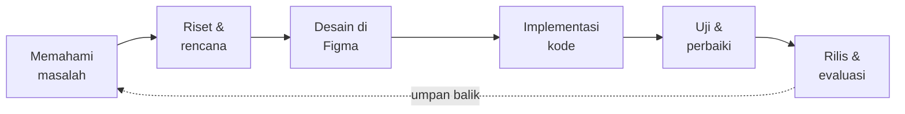

<!--
  ╔══════════════════════════════════════════════════════════════════╗
  ║  PROFILE README  ·  Fiha Aridhoi  ·  github.com/F1H444           ║
  ║                                                                  ║
  ║  Versi satu file. Tidak butuh folder assets, tidak butuh         ║
  ║  GitHub Actions. Cukup tempel file ini sebagai README.md di      ║
  ║  repositori F1H444/F1H444 lalu commit.                           ║
  ║                                                                  ║
  ║  Palet warna:                                                    ║
  ║    background  #0B0B14                                           ║
  ║    surface     #12122A                                           ║
  ║    aksen       #6366F1  (indigo)                                 ║
  ║    teks muda   #C7D2FE / #A5B4FC / #818CF8                       ║
  ╚══════════════════════════════════════════════════════════════════╝
-->

<!-- ═══════════════════════════════════════════════════════════════
     1. HEADER
     Banner bergelombang dengan animasi fade-in, dibuat oleh
     capsule-render. Warna memakai gradien gelap ke indigo.
     ═══════════════════════════════════════════════════════════════ -->

<div align="center">


<!-- Teks mengetik. Baris dipisah tanda titik koma, spasi ditulis sebagai plus. -->
<a href="https://github.com/F1H444">
  
</a>

<br/>

<!-- Badge ringkas. shields.io adalah salah satu layanan paling stabil. -->


<br/><br/>

<!-- Navigasi cepat ke setiap bagian. -->
<a href="#tentang"><b>Tentang</b></a>
&nbsp;·&nbsp;
<a href="#filosofi"><b>Filosofi</b></a>
&nbsp;·&nbsp;
<a href="#fokus"><b>Fokus</b></a>
&nbsp;·&nbsp;
<a href="#stack"><b>Tech Stack</b></a>
&nbsp;·&nbsp;
<a href="#belajar"><b>Belajar</b></a>
&nbsp;·&nbsp;
<a href="#progman"><b>ProgMan</b></a>
&nbsp;·&nbsp;
<a href="#alur"><b>Alur Kerja</b></a>
&nbsp;·&nbsp;
<a href="#statistik"><b>Statistik</b></a>
&nbsp;·&nbsp;
<a href="#faq"><b>FAQ</b></a>
&nbsp;·&nbsp;
<a href="#kontak"><b>Kontak</b></a>

</div>

<br/>

<!-- ═══════════════════════════════════════════════════════════════
     2. TENTANG SAYA
     ═══════════════════════════════════════════════════════════════ -->

<a id="tentang"></a>

## ✦ Tentang Saya

<table>
<tr>
<td width="62%" valign="top">

Halo, saya **Fiha Aridhoi**. Saya mahasiswa yang sedang mendalami **software engineering** dan tinggal di **Surabaya, Indonesia**.

Hal yang paling saya nikmati adalah mengubah ide menjadi sesuatu yang benar-benar bisa dipakai orang: sebuah website yang cepat dibuka, aplikasi yang tidak membingungkan, atau game kecil yang asyik dimainkan.

Saya percaya perangkat lunak yang baik punya tiga ciri: **efisien** (hemat sumber daya dan waktu), **inovatif** (tidak sekadar meniru), dan **user-friendly** (orang awam pun langsung paham cara memakainya).

Profil ini adalah ringkasan perjalanan saya: apa yang saya kerjakan, alat apa yang saya pakai, dan ke mana saya ingin berkembang.

</td>
<td width="38%" valign="middle" align="center">


</td>
</tr>
</table>

Berikut gambaran singkat saya dalam bentuk kode:

```ts
const fiha = {
  name:     "Fiha Aridhoi",
  username: "F1H444",
  location: "Surabaya, Indonesia",
  role:     "Software Engineering Student",

  focus: [
    "Modern Web Development",
    "Game Development",
    "UI/UX Design",
  ],

  learning: [
    "React Ecosystem",
    "Advanced Animations",
    "System Design",
  ],

  interests: ["Building Cool Stuff", "Open Source", "Problem Solving"],

  motto: "Learning by doing, growing by sharing",
  fuel:  "coffee -> code",

  openToCollaboration: true,
} as const;
```

<br/>

<!-- ═══════════════════════════════════════════════════════════════
     3. FILOSOFI KERJA
     Lima prinsip yang saya pegang, masing-masing dengan penjelasan.
     ═══════════════════════════════════════════════════════════════ -->

<a id="filosofi"></a>

## ✦ Filosofi Kerja

Ini lima prinsip yang saya pakai setiap kali memulai atau mereview sebuah proyek.

<table>
<tr>
<td width="8%" align="center"><h3>01</h3></td>
<td width="92%">

**Mulai dari masalah, bukan dari teknologi.**
Sebelum memilih framework, saya bertanya dulu: siapa penggunanya dan masalah apa yang ingin diselesaikan? Teknologi hanyalah alat. Pilihan alat yang tepat baru muncul setelah masalahnya jelas.

</td>
</tr>
<tr>
<td align="center"><h3>02</h3></td>
<td>

**Sederhana itu elegan.**
Kode yang mudah dibaca lebih berharga daripada kode yang terlihat pintar. Antarmuka yang bersih lebih berharga daripada antarmuka yang penuh efek. Kalau sesuatu bisa dibuat lebih sederhana tanpa kehilangan fungsi, saya sederhanakan.

</td>
</tr>
<tr>
<td align="center"><h3>03</h3></td>
<td>

**Animasi harus punya tujuan.**
Gerakan yang baik membantu pengguna memahami apa yang terjadi: elemen mana yang baru muncul, tombol mana yang bisa ditekan, perubahan apa yang barusan berlangsung. Animasi yang hanya menghias dan mengganggu akan saya buang.

</td>
</tr>
<tr>
<td align="center"><h3>04</h3></td>
<td>

**Belajar sambil membangun.**
Cara tercepat memahami sebuah konsep adalah memakainya di proyek nyata. Saya lebih suka membuat sesuatu yang kecil dan jalan daripada membaca teori terlalu lama tanpa praktik.

</td>
</tr>
<tr>
<td align="center"><h3>05</h3></td>
<td>

**Bagikan apa yang dipelajari.**
Ilmu yang dibagikan akan tumbuh. Karena itu saya suka open source: membaca kode orang lain, memperbaikinya, dan membuka hasil kerja sendiri agar bisa dipelajari orang lain.

</td>
</tr>
</table>

<br/>

<!-- ═══════════════════════════════════════════════════════════════
     4. FOKUS SAAT INI
     ═══════════════════════════════════════════════════════════════ -->

<a id="fokus"></a>

## ✦ Fokus Saat Ini

<div align="center">
<table>
<tr>
<td align="center" width="33%" valign="top">

<br/><br/>
<b>Web Development</b>
<br/>
<sub>React dan Next.js untuk antarmuka modern, cepat, dan responsif di semua ukuran layar.</sub>
</td>
<td align="center" width="33%" valign="top">

<br/><br/>
<b>Game Development</b>
<br/>
<sub>Godot Engine dan GDScript untuk membuat game 2D yang ringan dengan gameplay yang enak.</sub>
</td>
<td align="center" width="33%" valign="top">

<br/><br/>
<b>UI/UX Design</b>
<br/>
<sub>Figma untuk merancang alur dan tampilan sebelum satu baris kode ditulis.</sub>
</td>
</tr>
</table>
</div>

<br/>

<details>
<summary><b>Baca penjelasan tiap fokus</b></summary>

<br/>

### Web Development

Di web saya mengerjakan dua sisi sekaligus. Di **frontend**, saya membangun antarmuka berbasis komponen dengan React dan Next.js, lalu menatanya dengan Tailwind CSS. Di **backend**, saya memakai Laravel dan MySQL untuk logika bisnis, autentikasi, dan penyimpanan data.

Yang saya jaga selalu sama: halaman cepat dimuat, tampilan konsisten di ponsel dan desktop, dan struktur kode cukup rapi agar mudah dilanjutkan oleh siapa pun.

### Game Development

Game adalah tempat saya bereksperimen paling bebas. Godot Engine membuat saya bisa fokus pada ide: bagaimana karakter bergerak, bagaimana level terasa, dan bagaimana umpan balik visual membuat aksi pemain terasa memuaskan.

GDScript mirip Python sehingga mudah dibaca, dan itu sangat membantu ketika saya iterasi cepat.

### UI/UX Design

Desain yang baik membuat pengembangan jadi lebih mudah. Saya merancang di Figma: mulai dari alur pengguna, kerangka halaman, sampai sistem warna dan tipografi. Setelah desain disepakati, implementasi di kode terasa jauh lebih terarah.

</details>

<br/>

<!-- ═══════════════════════════════════════════════════════════════
     5. TECH STACK
     Ikon dari skillicons.dev, lalu tabel penjelasan kegunaan.
     ═══════════════════════════════════════════════════════════════ -->

<a id="stack"></a>

## ✦ Tech Stack

<div align="center">

**Bahasa Pemrograman**


<br/><br/>

**Frontend**


<br/>


<br/><br/>

**Backend dan Database**


<br/><br/>

**Game dan Tools**


</div>

<br/>

Ikon saja tidak menjelaskan banyak hal. Berikut untuk apa saya memakai masing-masing teknologi.

### Bahasa

| Bahasa | Saya memakainya untuk |
| :--- | :--- |
| **JavaScript** | Logika interaktif di browser dan dasar dari seluruh ekosistem frontend |
| **TypeScript** | Menambah tipe pada JavaScript agar kesalahan ketahuan sebelum aplikasi dijalankan |
| **Python** | Skrip otomasi, olah data, dan eksperimen cepat |
| **PHP** | Backend web, terutama bersama Laravel |
| **C++** | Memahami cara kerja program lebih dekat ke mesin dan struktur data |
| **C** | Dasar pemrograman, pointer, dan manajemen memori |
| **GDScript** | Menulis logika game di Godot Engine |

### Frontend

| Teknologi | Saya memakainya untuk |
| :--- | :--- |
| **React** | Membangun UI dari komponen yang bisa dipakai ulang |
| **Next.js** | Routing, rendering di server, dan optimasi performa untuk aplikasi React |
| **Tailwind CSS** | Menata tampilan dengan cepat dan konsisten langsung dari markup |
| **Bootstrap** | Prototipe cepat dengan komponen siap pakai |
| **Alpine.js** | Interaksi ringan tanpa perlu framework besar |
| **Framer Motion** | Animasi halus dan deklaratif di React |
| **GSAP** | Animasi kompleks dengan kontrol timeline yang presisi |
| **Figma** | Desain antarmuka, wireframe, dan sistem desain |

### Backend dan Database

| Teknologi | Saya memakainya untuk |
| :--- | :--- |
| **Laravel** | Framework PHP untuk routing, autentikasi, ORM, dan struktur proyek yang terarah |
| **MySQL** | Database relasional untuk menyimpan dan menghubungkan data aplikasi |
| **Postman** | Menguji dan mendokumentasikan endpoint API |

### Game dan Tools

| Alat | Saya memakainya untuk |
| :--- | :--- |
| **Godot Engine** | Membuat game 2D dan 3D yang ringan dan open source |
| **Git** | Mencatat riwayat perubahan dan bekerja di banyak cabang |
| **GitHub** | Menyimpan repositori, kolaborasi, dan berbagi proyek |
| **GitLab** | Alternatif hosting repositori dan pipeline CI |
| **VS Code** | Editor utama untuk hampir semua bahasa di atas |
| **Android Studio** | Mengembangkan dan menguji aplikasi mobile Android |

<br/>

<!-- ═══════════════════════════════════════════════════════════════
     6. SEDANG DIPELAJARI
     ═══════════════════════════════════════════════════════════════ -->

<a id="belajar"></a>

## ✦ Sedang Dipelajari

Berhenti belajar sama dengan berhenti berkembang. Tiga hal ini sedang jadi prioritas saya.

<table>
<tr>
<td width="33%" valign="top">

#### React Ecosystem

Bukan hanya React itu sendiri, tapi seluruh ekosistemnya: manajemen state, pola komponen, server components, data fetching, dan cara menguji komponen.

**Tujuan:** bisa merancang aplikasi React skala menengah dengan struktur yang bersih.

</td>
<td width="33%" valign="top">

#### Advanced Animations

Mendalami timeline, easing, scroll-triggered animation, dan transisi antarhalaman, serta bagaimana menjaganya tetap lancar di perangkat yang tidak terlalu kuat.

**Tujuan:** animasi yang terasa natural dan tidak membebani performa.

</td>
<td width="33%" valign="top">

#### System Design

Belajar memikirkan aplikasi sebagai sistem: bagaimana data mengalir, bagaimana komponen dipisahkan, apa yang terjadi saat pengguna bertambah banyak.

**Tujuan:** membuat keputusan arsitektur yang bisa saya pertanggungjawabkan.

</td>
</tr>
</table>

<br/>

<details>
<summary><b>Cara saya belajar</b></summary>

<br/>

1. **Pilih satu konsep kecil.** Misalnya hanya soal scroll animation, bukan seluruh GSAP.
2. **Buat contoh minimal yang jalan.** Satu halaman, satu efek, tanpa fitur tambahan.
3. **Rusak dengan sengaja.** Ubah parameter, hapus bagian, lihat apa yang pecah. Dari situ konsepnya benar-benar melekat.
4. **Pakai di proyek nyata.** Konsep baru terasa dipahami kalau sudah menyelesaikan masalah sungguhan.
5. **Tulis ulang dengan kata sendiri.** Kalau bisa menjelaskannya dengan sederhana, berarti sudah paham.

</details>

<br/>

<!-- ═══════════════════════════════════════════════════════════════
     7. PROGMAN
     Layanan pembuatan website dan aplikasi untuk bisnis.
     ═══════════════════════════════════════════════════════════════ -->

<a id="progman"></a>

## ✦ ProgMan: Jasa Website dan Aplikasi

Selain belajar dan bereksperimen, saya menawarkan jasa pembuatan **website dan aplikasi untuk bisnis** lewat **ProgMan**.

<div align="center">

<a href="https://progman.is-a.dev/">
  
</a>

</div>

<br/>

### Yang bisa dikerjakan

| Layanan | Cocok untuk | Hasil yang didapat |
| :--- | :--- | :--- |
| **Landing page** | Promosi produk atau acara | Satu halaman yang fokus mengubah pengunjung menjadi pelanggan |
| **Company profile** | Usaha yang ingin tampil profesional | Situs yang menjelaskan siapa Anda, apa layanannya, dan cara menghubungi |
| **Web app** | Bisnis dengan proses yang ingin dirapikan | Aplikasi web dengan login, dashboard, dan pengelolaan data |
| **Aplikasi mobile** | Layanan yang dekat dengan pengguna harian | Aplikasi yang nyaman dipakai di ponsel |
| **Perbaikan tampilan** | Situs lama yang terasa kuno atau lambat | Antarmuka segar, lebih cepat, dan lebih mudah dipakai |

### Kenapa memilih ProgMan

- **Desain bersih dan modern.** Tidak ramai, tidak norak, dan sesuai karakter bisnis Anda.
- **Responsif.** Tampil baik di ponsel, tablet, dan desktop.
- **Cepat.** Performa dijaga sejak awal, bukan diperbaiki di akhir.
- **Komunikasi jelas.** Anda tahu apa yang sedang dikerjakan dan apa langkah berikutnya.
- **Bisa dikembangkan.** Kode disusun rapi agar fitur baru mudah ditambahkan nanti.

Detail layanan dan cara memesan ada di situs ProgMan.

<br/>

<!-- ═══════════════════════════════════════════════════════════════
     8. ALUR KERJA
     ═══════════════════════════════════════════════════════════════ -->

<a id="alur"></a>

## ✦ Alur Kerja Saya

Setiap proyek, besar atau kecil, saya jalankan dengan urutan yang sama.

<div align="center">



</div>

| Tahap | Apa yang terjadi | Hasilnya |
| :--- | :--- | :--- |
| **1. Memahami masalah** | Bertanya: siapa pengguna, apa tujuannya, apa batasannya | Daftar kebutuhan yang jelas |
| **2. Riset dan rencana** | Memilih teknologi, memecah pekerjaan menjadi tugas kecil | Rencana dan urutan pengerjaan |
| **3. Desain** | Wireframe, alur halaman, warna, dan tipografi di Figma | Desain yang bisa disetujui sebelum coding |
| **4. Implementasi** | Menulis kode per fitur, commit kecil dan sering | Fitur yang berjalan |
| **5. Uji dan perbaiki** | Mencoba di berbagai perangkat, merapikan bug dan performa | Produk yang stabil |
| **6. Rilis dan evaluasi** | Meluncurkan, mengumpulkan masukan, lalu memperbaiki | Siklus perbaikan berikutnya |

<br/>

<!-- ═══════════════════════════════════════════════════════════════
     9. STATISTIK GITHUB
     Kartu statistik memakai warna yang sama dengan seluruh profil.
     Layanan ini gratis dan kadang lambat. Kalau gambar sesekali
     kosong, itu karena server layanannya sibuk, bukan salah kode.
     ═══════════════════════════════════════════════════════════════ -->

<a id="statistik"></a>

## ✦ Statistik GitHub

<div align="center">


<br/>


<br/><br/>


</div>

<br/>

<details>
<summary><b>Cara membaca statistik ini</b></summary>

<br/>

- **Kartu statistik** merangkum total bintang, commit, pull request, issue, dan kontribusi.
- **Streak** menunjukkan berapa hari berturut-turut ada kontribusi. Angka bukan tujuan utama, tapi konsistensi itu kebiasaan baik.
- **Bahasa terbanyak** dihitung dari ukuran kode di repositori publik, jadi bukan berarti bahasa lain tidak dikuasai.
- **Grafik aktivitas** memperlihatkan naik turunnya kontribusi dari waktu ke waktu.

Statistik hanyalah gambaran kasar. Kualitas kode dan dampak sebuah proyek tidak bisa diukur dari angka.

</details>

<br/>

<!-- ═══════════════════════════════════════════════════════════════
     10. PROYEK UNGGULAN (OPSIONAL)
     Bagian ini sengaja dinonaktifkan agar profil tidak terlihat
     kosong. Untuk mengaktifkan:
       1. Hapus tanda pembuka komentar dan penutupnya.
       2. Ganti NAMA-REPO dengan nama repositori sebenarnya.
       3. Salin blok <a> untuk menambah proyek lain.
     ═══════════════════════════════════════════════════════════════ -->

<!--
<a id="proyek"></a>

## ✦ Proyek Unggulan

<div align="center">

<a href="https://github.com/F1H444/NAMA-REPO-1">
  
</a>
<a href="https://github.com/F1H444/NAMA-REPO-2">
  
</a>

</div>
-->

<!-- ═══════════════════════════════════════════════════════════════
     11. FUN FACT
     ═══════════════════════════════════════════════════════════════ -->

## ✦ Sedikit Tentang Kebiasaan Saya

```text
$ whoami
fiha

$ cat habits.txt
- mengubah kopi menjadi kode
- sering menambah fitur "sekali lagi" lalu lupa waktu
- suka merapikan antarmuka sampai jarak antar elemen pas
- mencoba tools baru tiap ada kesempatan

$ cat motto.txt
Learning by doing, growing by sharing
```

<br/>

<!-- ═══════════════════════════════════════════════════════════════
     12. FAQ
     ═══════════════════════════════════════════════════════════════ -->

<a id="faq"></a>

## ✦ Pertanyaan yang Sering Muncul

<details>
<summary><b>Apakah kamu terbuka untuk kolaborasi?</b></summary>

<br/>

Ya, saya terbuka untuk kolaborasi di proyek web, game, maupun open source. Cara terbaik adalah membuka issue atau diskusi di salah satu repositori saya, atau menghubungi lewat situs ProgMan.

</details>

<details>
<summary><b>Teknologi apa yang sebaiknya dipelajari pertama kali?</b></summary>

<br/>

Mulailah dari dasar: HTML, CSS, dan JavaScript. Setelah itu pilih satu framework (misalnya React) dan bangun satu proyek kecil sampai selesai. Jangan melompat-lompat antar teknologi sebelum satu proyek rampung.

</details>

<details>
<summary><b>Berapa lama proses pembuatan sebuah website lewat ProgMan?</b></summary>

<br/>

Tergantung ruang lingkupnya. Landing page sederhana jauh lebih cepat daripada web app dengan login dan dashboard. Setelah kebutuhan Anda jelas, estimasi waktu bisa dibahas bersama.

</details>

<details>
<summary><b>Kenapa kamu memakai Laravel dan Next.js sekaligus?</b></summary>

<br/>

Keduanya punya kekuatan yang berbeda. Laravel nyaman untuk backend yang butuh struktur, autentikasi, dan database. Next.js unggul untuk frontend modern dengan performa baik. Untuk beberapa proyek, keduanya bisa dipadukan: Laravel sebagai API dan Next.js sebagai tampilan.

</details>

<details>
<summary><b>Apakah kamu menerima proyek game?</b></summary>

<br/>

Game adalah area yang masih saya dalami lewat Godot Engine, jadi saat ini saya lebih sering mengerjakannya sebagai proyek pribadi dan eksperimen. Kalau ada ide menarik, silakan ajak ngobrol.

</details>

<details>
<summary><b>Bagaimana cara melaporkan bug di proyek saya?</b></summary>

<br/>

Buka tab **Issues** di repositori terkait. Sertakan langkah untuk mengulang masalahnya, apa yang Anda harapkan, dan apa yang sebenarnya terjadi. Tangkapan layar sangat membantu.

</details>

<br/>

<!-- ═══════════════════════════════════════════════════════════════
     13. KONTAK
     ═══════════════════════════════════════════════════════════════ -->

<a id="kontak"></a>

## ✦ Mari Terhubung

Punya ide, pertanyaan, atau ingin bekerja sama? Pintu saya terbuka.

<div align="center">

<a href="https://github.com/F1H444">
  
</a>
<a href="https://progman.is-a.dev/">
  
</a>

<br/><br/>

<sub>Kalau Anda menyukai proyek saya, beri bintang pada repositorinya. Itu sangat berarti.</sub>

</div>

<br/>

<!-- ═══════════════════════════════════════════════════════════════
     14. PENUTUP DAN FOOTER
     ═══════════════════════════════════════════════════════════════ -->

<div align="center">

<i>"Code is like humor. When you have to explain it, it's bad."</i>

<br/><br/>

<sub>Dibuat dengan kopi dan rasa ingin tahu oleh <b>Fiha Aridhoi</b></sub>


</div>
